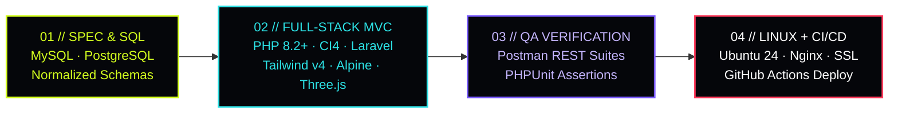

<div align="center">
  <a href="https://mabdeira.dev">
    
  </a>

  <br />

  <a href="https://mabdeira.dev">
    
  </a>

  <br />

  [](https://mabdeira.dev)
  [](https://mabdeira.dev/demo/linklearn-ai)
  [](https://linkedin.com/in/m4b007)
  [](mailto:contact@mabdeira.dev)
</div>

---

### `01 // INTERACTIVE SHELL — WHOAMI`

```bash
amine@mabdeira.dev:~$ cat /etc/operator.json
```
```json
{
  "operator": "Mostepha Amine Bdeira",
  "handle": "@z3rokernel",
  "location": "Lyon, France (CET)",
  "languages": ["French (B2)", "English (C1)", "Arabic (Native)"],
  "experience": "8+ years freelance Full-Stack Web & SQL Engineering",
  "delivered": "30+ bespoke platforms (E-Commerce, ERP/CRM, LMS, APIs)",
  "degree": "Master in Intelligent Computer Systems (UCBET // ENIC-NARIC Level 7)",
  "status": "OPEN TO FULL-STACK PHP (LARAVEL / CI4), SQL & QA ROLES"
}
```

---

### `02 // SYSTEM ARCHITECTURE & QA WORKFLOW`



---

### `03 // PRODUCTION CASE STUDIES (TELEMETRY)`

| ID | System | Core Engineering & Measurable Output | Endpoint |
| :---: | :--- | :--- | :--- |
| **`01`** | **SHOPPING FRANCE** | Cross-border FR→DZ **58-Wilaya COD** storefront (FR/AR) + analytics `/demo` + **Honeypot & Data-Poisoning Defense v2.0** (`x4–x7` trap prices neutralizing ByteSpider, GPTBot, Scrapy) | [`shoppingfrance.store`](https://shoppingfrance.store) · [`/demo`](https://shoppingfrance.store/demo) |
| **`02`** | **LINKLEARN AI** | Master's Thesis (Level 7) LMS: **Keras DLRM** (`50`-dim embeddings + `Dense-100 ReLU`, `RMSE 0.8718`, `-20.8%` error) + **Flask SVD** on `3,522` Coursera courses + **Claude-3-Opus** & `YouTubeTranscriptApi` quiz engine | [`mabdeira.dev/demo/linklearn-ai`](https://mabdeira.dev/demo/linklearn-ai) |
| **`03`** | **JYZ FACTURE (ERP)** | B2B **Pointages** (weekly shift tracking), multi-cadence PDF invoicing (`Quinzaine`/Month), **Chart.js AI Revenue Forecast**, partial payments, `Relances` & **OAuth2 Dropbox/GDrive backups** | [`tachouchejyz.rf.gd`](https://tachouchejyz.rf.gd) |
| **`04`** | **MABDEIRA.DEV** | Sci-fi portfolio running on **CodeIgniter 4.7**, **Three.js GLSL FBM shaders**, **GSAP 3**, **Lenis**, **Barba.js**, **Matter.js** physics & **GitHub Actions** SSH auto-deploy to IONOS Ubuntu/Nginx | [`mabdeira.dev`](https://mabdeira.dev) |

---

### `04 // TECH MATRIX`

<div align="center">

| Domain | Stack |
| :--- | :--- |
| **Backend & APIs** |     |
| **Data & SQL** |     |
| **Frontend & WebGL** |     |
| **QA & Infra** |     |

</div>

---

### `05 // LIVE GITHUB TELEMETRY`

<div align="center">


<br />


</div>

---

<div align="center">

```text
[ END OF TRANSMISSION // PRESS CMD+K ON MABDEIRA.DEV ]
```

[](https://mabdeira.dev)

</div>
